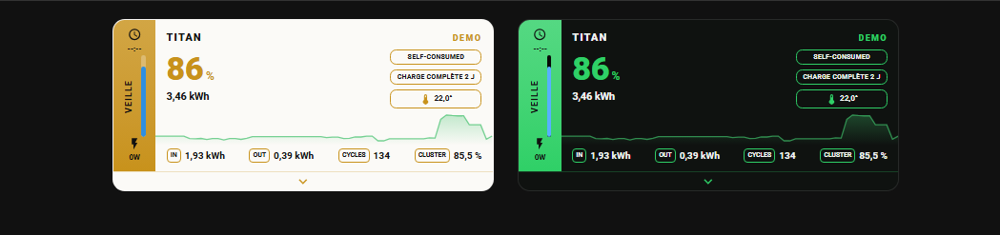
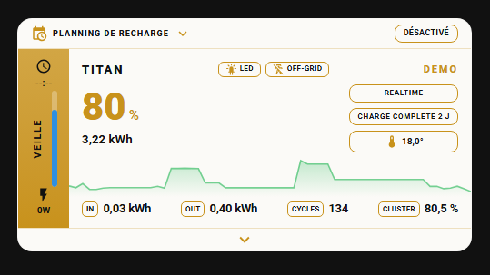
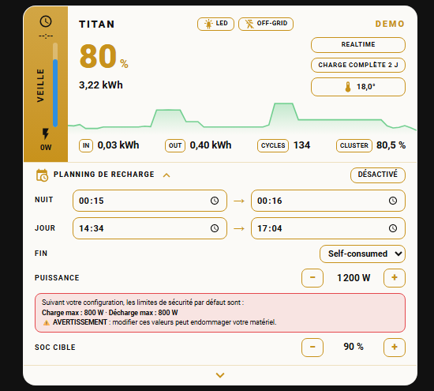

# Titan Status Card

Cartes Lovelace pour Home Assistant : état d'une batterie de stockage (SOC, charge / décharge / veille,
puissance, courbe, compteurs), avec un module **Link** repliable. Deux styles : **blanc et doré** ou **noir et vert**.

> Projet communautaire, non affilié à un fabricant. Aucune marque n'est affichée par défaut :
> le texte en haut à droite se règle avec l'option `brand`.

## Aperçu

Carte repliée, puis avec le module Link déplié (flèche sous la carte), en blanc et doré ou en noir et vert :




Plusieurs modules Link peuvent être empilés (ici 5) :


## Installation

### Avec HACS (dépôt personnalisé)
1. HACS → menu ⋮ → **Dépôts personnalisés**.
2. Ajoute l'adresse de ce dépôt, type **Tableau de bord** (*Dashboard*).
3. Installe **Titan Status Card**, puis recharge la page en vidant le cache.

### À la main
1. Copie `titan-status-card.js` dans `/config/www/`.
2. Paramètres → Tableaux de bord → ⋮ → **Ressources** → ajoute `/local/titan-status-card.js` (type *Module JavaScript*).

## Exemple

```yaml
type: custom:titan-status-card
name: Titan
brand: MA MAISON            # facultatif, texte en haut à droite
palette: gold               # gold (blanc et doré) ou green (noir et vert)
soc_entity: sensor.ma_batterie_soc
power_entity: sensor.ma_batterie_puissance   # positif = charge
state_entity: sensor.ma_batterie_etat        # Charging / Discharging / Static
floor_entity: number.soc_minimum
mode_entity: sensor.ma_batterie_mode
days_entity: sensor.jours_depuis_charge_complete
show_temps: true
temps:
  - label: 🌡️
    entity: sensor.ma_batterie_temperature
footer:
  - {label: IN, entity: sensor.energie_chargee_jour}
  - {label: OUT, entity: sensor.energie_dechargee_jour}
  - {label: CYCLES, entity: sensor.cycles, decimals: 0}
link:                       # module repliable sous la carte (facultatif)
  name: Link
  floor_entity: number.soc_minimum
  soc_entity: sensor.link_soc
  temp_entity: sensor.link_temperature
  cycles_entity: sensor.link_cycles
```

Seul `soc_entity` est obligatoire.

## Éditeur visuel

La carte se configure aussi **sans YAML** : ajoute-la depuis le sélecteur de cartes (« Titan Status Card »), ou ouvre ta carte puis **Modifier**. L'éditeur propose des sections repliables : Général, Entités (avec recherche d'entités), Boutons de commande, Planning de recharge (plages, puissance, SOC cible, position) et Modules Link (jusqu'à 5). Avec l'intégration izypower_titan, choisis le SOC (`…_pile_average`) : la puissance (`…_ac_input_and_output`), l'état (`…_battery_state`) et le mode (`…_working_mode`) sont remplis automatiquement s'ils existent. Chaque champ affiche un exemple de nom d'entité. Les options absentes de l'éditeur (`pv`, `temps`, `footer`, couleurs…) restent dans le YAML et sont conservées.

## Options principales

| Option | Rôle |
|---|---|
| `name`, `brand` | Nom de la carte, texte en haut à droite (vide par défaut) |
| `palette` | `gold` (défaut) ou `green` |
| `gold` / `green` | Couleur d'accent de chaque style |
| `soc_entity` | SOC de la batterie (obligatoire) |
| `power_entity`, `power_charge_positive` | Puissance et son signe (positif = charge par défaut) |
| `state_entity` | Texte d'état (Charging, Discharging, Static…) ; sinon déduit de la puissance |
| `floor_entity` | SOC minimum : barre et pourcentage passent en rouge en dessous |
| `mode_entity`, `mode_labels` | Mode de travail et traduction des libellés |
| `days_entity`, `days_label` | Jours depuis la dernière charge complète |
| `temps` + `show_temps` | Pastilles de température |
| `footer` | Jusqu'à 4 compteurs (`label`, `entity`, `unit`, `decimals`) |
| `link` | Module Link repliable (`soc_entity`, `temp_entity`, `cycles_entity`, `infos`) |
| `controls` | Boutons dans l'en-tête pour commander des interrupteurs (`switch`, `input_boolean`, `light`) : `entity`, `label`, `icon`, `confirm` |
| `planning` | Section repliable « Planning de recharge » : interrupteur, plages horaires, puissance et SOC cible (voir ci-dessous) |
| `labels`, `bar_colors`, `bar_colors_dark`, `curve_color` | Libellés et couleurs |
| `show_ring` | Cercle d'état à droite (désactivé par défaut) |

Boutons de commande (par exemple LED et mode hors réseau) dans l'en-tête de la carte : icônes seules sur écran étroit, avec leur nom sur écran large. `confirm: true` demande un second appui avant d'agir, et `controls_position: bottom` les place en rangée sous la carte :

```yaml
controls:
  - {entity: switch.ma_batterie_leds, label: LED}
  - {entity: switch.ma_batterie_off_grid, label: Off-grid, confirm: true}
```

### Planning de recharge

Section repliable sous la carte (la flèche « Planning de recharge ») : un interrupteur Activé / Désactivé / En cours, des plages horaires modifiables, la puissance et le SOC cible avec des boutons + et −.

Aperçu : replié, puis déplié (section placée au-dessus de la Titan avec `position: top`).




Au-dessus de la puissance limite (800 W par défaut), un avertissement s'affiche :



La section se place sous la Titan (par défaut) ou au-dessus (`position: top`), avec ou sans module Link :


**La carte ne fait que lire et écrire des entités : la recharge elle-même est pilotée par des automatisations.** Elles sont fournies dans [`planning/planning_recharge.yaml`](planning/planning_recharge.yaml) (batteries Izypower Titan avec l'intégration [izypower_titan](https://github.com/khirale/izypower_titan)). Le planning est **manuel** : tu l'actives toi-même. À l'heure de début, la batterie passe en RealTime, règle la puissance et le SOC cible, puis lance la charge. À la fin (heure de fin ou SOC atteint), l'action choisie s'exécute : **Standby** (par défaut : la charge s'arrête et la Titan reste en RealTime) ou **Self-consumed** (retour à l'autoconsommation). Le planning se coupe ensuite : il faut le réactiver à la main.

> Après un Standby, la batterie ne se recharge plus avec le solaire tant que tu n'as pas choisi un autre mode. Choisis « Self-consumed » comme action de fin si tu veux revenir à l'autoconsommation automatiquement.

> ⚠️ La recharge se fait sur le réseau. Teste d'abord à faible puissance (500 W) en surveillant la batterie. Utilisation à tes risques.
>
> ⚠️ **AVERTISSEMENT** : suivant ta configuration, les limites de sécurité par défaut sont **charge max 800 W** et **décharge max 800 W**. Modifier ces valeurs peut endommager ton matériel. La carte affiche cet avertissement dès que la puissance de recharge dépasse 800 W (réglable avec `power_warn`, personnalisable avec `power_warn_text`).

Installation du planning :

1. Dans `configuration.yaml`, vérifie que les paquets sont activés :
   ```yaml
   homeassistant:
     packages: !include_dir_named packages
   ```
2. Copie `planning/planning_recharge.yaml` dans `/config/packages/`.
3. Ouvre le fichier et modifie **uniquement le bloc « RÉGLAGES À ADAPTER »** (4 lignes, dans la première automatisation) : capteur de SOC, capteur `working_mode` de ta Titan principale, puissance AC totale des batteries (positive en charge) et service de notification. Rien d’autre à changer. Vérifie que les entités `number.cluster_*` et `button.cluster_*` existent chez toi.
4. Redémarre Home Assistant. Règle les heures, la puissance et le SOC cible dans les entrées créées.
5. Ajoute la section à la carte de ta Titan principale (une seule carte, car le planning commande tout le cluster) :

```yaml
planning:
  name: Planning de recharge          # facultatif
  enable_entity: input_boolean.planning_recharge_actif
  active_entity: input_boolean.planning_recharge_en_cours   # facultatif : affiche « En cours »
  slots:                               # jusqu'à 4 plages
    - {label: Nuit, start: input_datetime.planning_recharge_debut_nuit, end: input_datetime.planning_recharge_fin_nuit}
    - {label: Jour, start: input_datetime.planning_recharge_debut_jour, end: input_datetime.planning_recharge_fin_jour}
  power_entity: input_number.planning_recharge_puissance
  soc_entity: input_number.planning_recharge_soc_cible
  power_warn: 800                      # facultatif : seuil (W) de l'avertissement, 800 par défaut
  position: top                        # facultatif : section au-dessus de la Titan (par défaut : en dessous)
  end_entity: input_select.planning_recharge_fin   # facultatif : choix de l'action de fin
```

La section n'apparaît que si `planning` est présent : sans cette option, la carte est inchangée. Les heures peuvent être des `input_datetime` (heure seule) ou des entités `time` ; la puissance et le SOC, des `input_number` ou `number`.

`link` accepte aussi une **liste** pour plusieurs modules Link sous la même carte :

```yaml
link:
  - {name: Link 1, soc_entity: sensor.link1_soc, temp_entity: sensor.link1_temperature, cycles_entity: sensor.link1_cycles}
  - {name: Link 2, soc_entity: sensor.link2_soc, temp_entity: sensor.link2_temperature, cycles_entity: sensor.link2_cycles}
```

Le Link se déplie avec la flèche sous la carte ; le choix est retenu sur chaque appareil.
La carte `custom:titan-link-card` existe aussi seule (mêmes options `soc_entity`, `temp_entity`, `cycles_entity`).

## Licence
MIT
